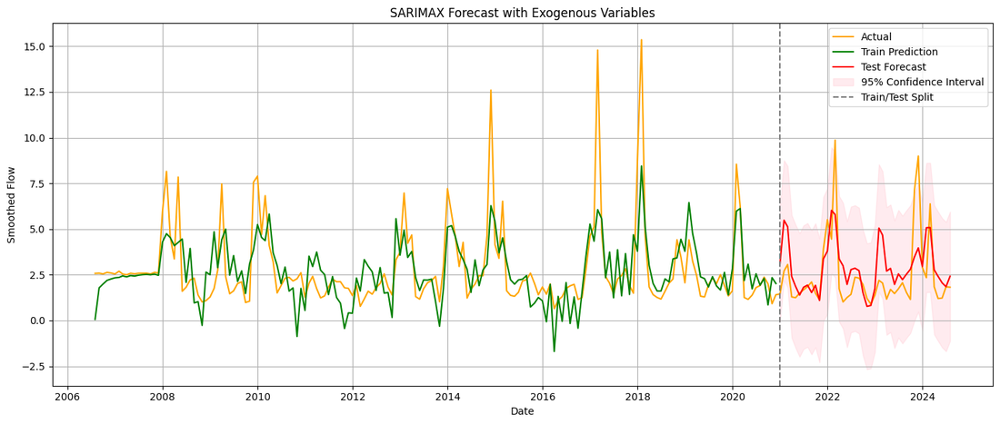
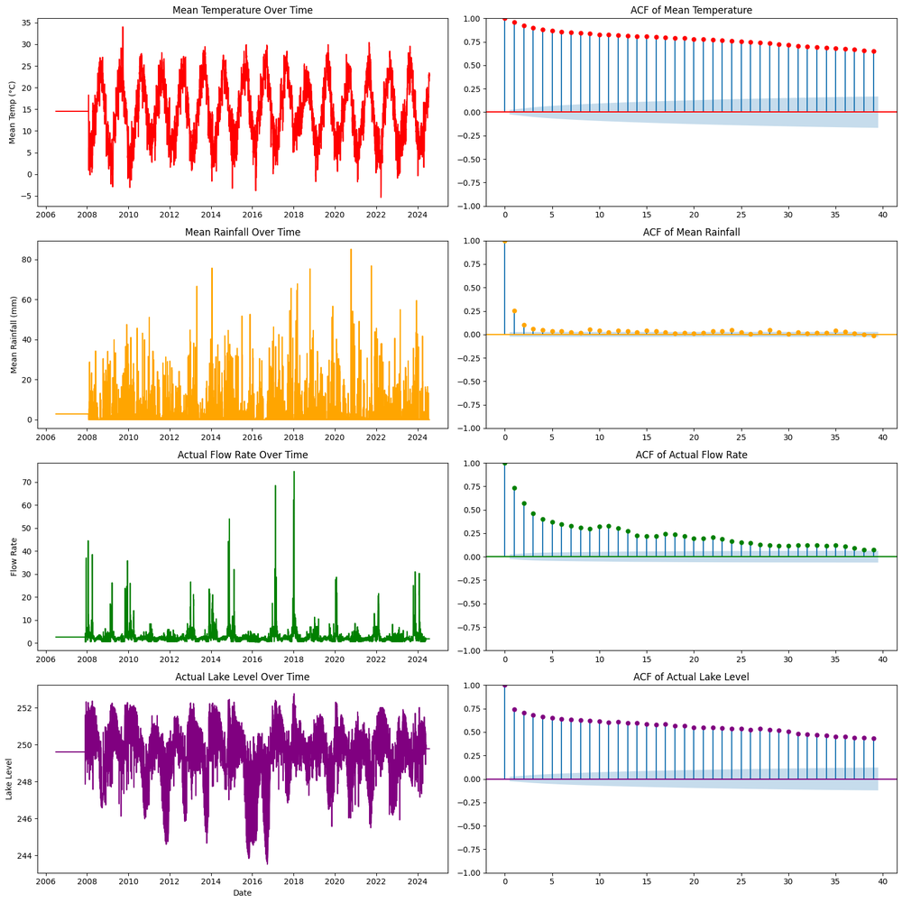
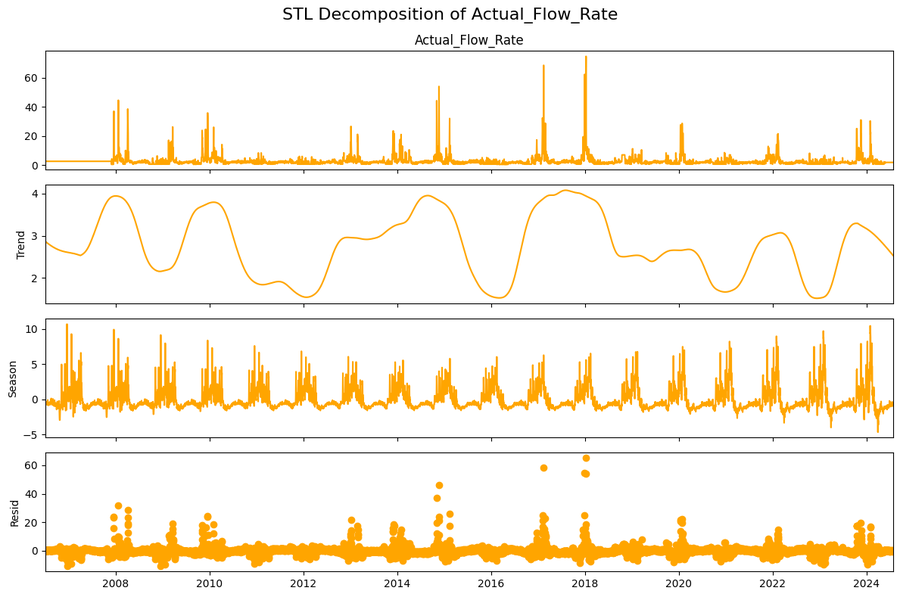
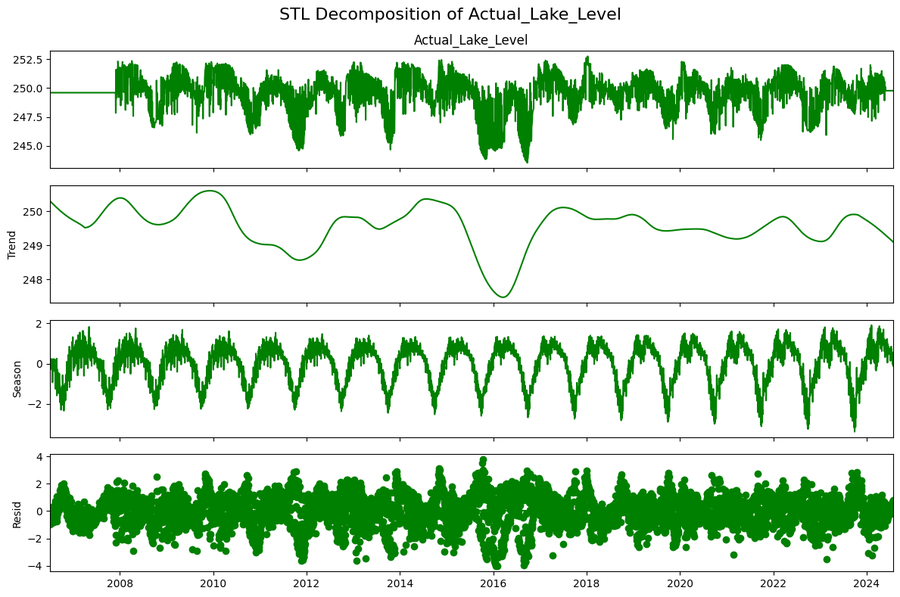
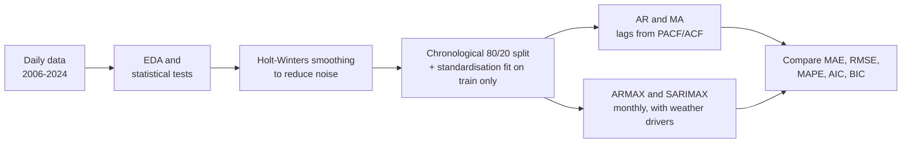
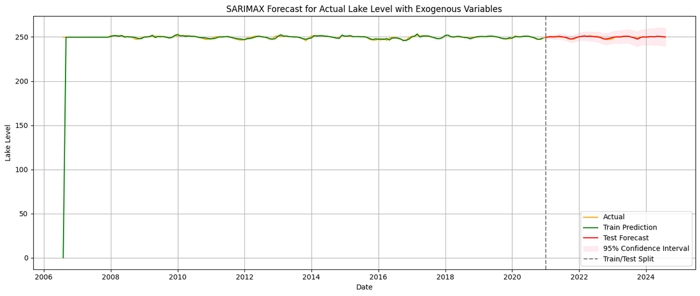

# Smart Water Management: Forecasting Lake Level and Inflow

Forecasting a lake's **water level** and **inflow rate** from 18 years of daily weather and hydrological data, comparing classical time-series models from simple autoregression up to **SARIMAX** with seasonal terms and weather drivers.




## Highlights

- **Two forecasting targets:** lake level (slow, stable) and inflow rate (spiky, storm-driven).
- **Four models compared** on a chronological hold-out set: AR, MA, ARMAX and SARIMAX.
- **SARIMAX performed best on both targets.** For lake level it reached an error of **0.39 (MAE) and 0.16% (MAPE)**, cutting MAE by more than half compared with the best simpler model. For inflow it reduced MAPE from over 300% (AR/MA) to 56%.
- **Full statistical workflow:** stationarity tests (ADF, KPSS, Phillips–Perron), normality tests, ACF/PACF lag selection, STL decomposition, Holt–Winters smoothing and residual diagnostics.

## Problem

Reliable lake-level and inflow forecasts support water supply planning, flood preparedness and agriculture. The challenge is that inflow is driven by irregular rainfall events, while the lake level responds slowly and seasonally. A good model must capture both memory and external weather effects.

## Data

- **6,603 daily records**, July 2006 – 2024, with four variables: mean rainfall, mean temperature, inflow rate and lake level.
- Provided as a course dataset (`lakes_fe.csv`), so it is not included in this repository.



**What the exploration showed**
- **Temperature and lake level have long memory** (slowly decaying autocorrelation). Rainfall behaves almost randomly day to day.
- **Rainfall and inflow are heavily right-skewed**, with rare extreme peaks. No variable is normally distributed (Kolmogorov–Smirnov test).
- **All series are stationary** according to ADF, KPSS and Phillips–Perron tests, so no differencing was needed.
- **Lake level correlates with inflow (+0.34) and temperature (−0.39)**, consistent with inflow raising the lake and evaporation lowering it.

<details>
<summary>STL decomposition (trend, seasonality, residuals)</summary>



</details>

## Approach



- **Preprocessing:** Holt–Winters smoothing (additive trend and yearly seasonality), a chronological train/test split with no shuffling, and a scaler fitted only on training data to avoid leakage.
- **AR / MA:** univariate baselines on the daily series, with lag orders chosen from PACF/ACF and information criteria.
- **ARMAX / SARIMAX:** monthly averages with external drivers. Lake level uses rainfall, temperature and inflow; inflow uses rainfall, temperature and lake level. SARIMAX(2,0,2)(1,0,1)₁₂ adds a yearly seasonal component.

## Results

Test-set errors (lower is better):

**Lake level**

| Model | MAE | RMSE | MAPE |
|---|---:|---:|---:|
| AR | 0.851 | 1.044 | 0.34% |
| MA | 0.933 | 1.187 | 0.37% |
| ARMAX | 1.02 | 1.18 | 0.41% |
| **SARIMAX** | **0.39** | **0.50** | **0.16%** |

**Inflow rate**

| Model | MAE | RMSE | MAPE |
|---|---:|---:|---:|
| AR | 1.861 | 3.055 | 312.48% |
| MA | 1.871 | 3.056 | 315.58% |
| ARMAX | 1.61 | 2.08 | 81.51% |
| **SARIMAX** | **1.23** | **1.68** | **55.69%** |



## Key takeaways

- **Seasonality and weather drivers matter.** Adding exogenous variables (ARMAX) helped with inflow, and adding seasonality on top (SARIMAX) gave the best results for both targets.
- **Lake level is highly predictable;** inflow is not. Inflow's sudden storm-driven peaks are still underestimated, which explains its high MAPE (relative errors explode when inflow is near zero).
- **Possible next steps:** lagged rainfall features to capture the delay between rain and inflow, and machine-learning models (gradient boosting, LSTM) benchmarked against this SARIMAX baseline.

## Repository structure

```
lake-forecasting-time-series/
├── notebooks/
│   └── lake_level_and_flow_forecasting.ipynb   # EDA, tests, preprocessing, models, evaluation
├── figures/                                     # figures used in this README
├── docs/
│   └── report_summary.md                        # summary of the technical report
└── requirements.txt
```

## How to run

```bash
pip install -r requirements.txt
jupyter notebook notebooks/lake_level_and_flow_forecasting.ipynb
```

The notebook was developed on Google Colab and reads the dataset from `/content/lakes_fe.csv`. Place a CSV with the columns `Date, Mean_Rainfall, Mean_Temp, Actual_Flow_Rate, Actual_Lake_Level` at that path, or update the path in the first code cell.

## Project context

Project for the *Hardware and Software for Big Data* course, MSc Data Science, University of Naples Federico II (June 2025). A summary of the technical report is in [`docs/report_summary.md`](docs/report_summary.md).
